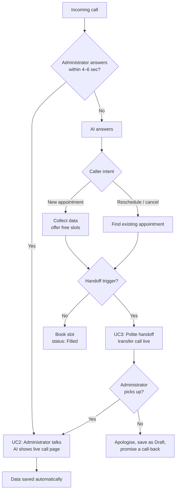
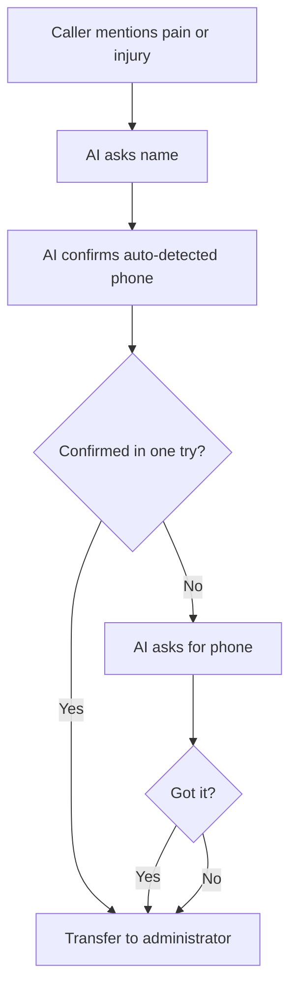
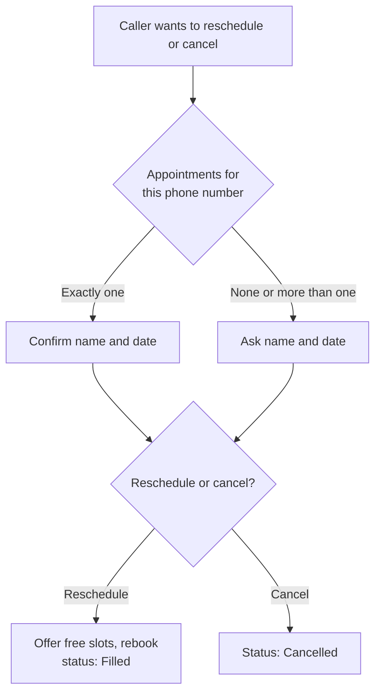

# Demo Process: AI Call Assistant for a Dental Clinic

## 1. Scope

- **Niche:** dental clinic.
- **Channel:** live phone call to a real number from a SIP-telephony provider.
- **Language:** English only.
- **Out of scope:** chat messages. They are a separate set of use-cases that follow the same logic.

## 2. Actors

| Actor | Description |
|---|---|
| Administrator | Real person (business owner or clinic administrator). Only one in the demo. |
| Caller | Patient or potential patient who needs a dental service. |
| AI Assistant | Our system. It answers calls, talks to the caller and books appointments. |

## 3. System Components

### 3.1 Administrator web page
- **Appointments:** list of appointments with their statuses.
- **Schedule:** a shared clinic schedule plus each doctor's schedule.
- **Incoming calls:** the live call page, call recordings and transcripts.

### 3.2 Live call page
Opens for every call, whether the AI or the administrator is talking. It shows:
- the current funnel stage (detected automatically from speech);
- appointment fields, with the filled ones and the missing ones marked;
- the conversation script with the estimated current position in it;
- the live speech-to-text transcript.

All data is saved automatically while the call goes on. Every call is recorded and transcribed.

### 3.3 AI Assistant settings
- **Knowledge base:** text and FAQ entered in a form, plus uploaded files.
- **Services list.** Each service has these fields:

| Field | Example |
|---|---|
| Name | Teeth cleaning |
| Urgent | yes / no |
| Price range | $80–120 |
| Expected duration | 45 min |
| Doctor speciality | Hygienist |

- **Schedule access:** the AI reads free slots and books them itself.

## 4. Appointment Data

| Field | Required |
|---|---|
| Patient name | Yes |
| Phone (auto-detected from caller ID, confirmed by caller) | Yes |
| Service | Yes |
| Date and time | Yes |
| New or returning patient | Yes |
| Complaint | Yes |
| Doctor | No. The caller may choose a doctor; otherwise one is assigned automatically later |
| Insurance number | No |

## 5. Appointment Statuses

| Status | Meaning | Set by |
|---|---|---|
| Draft | Data is still being collected, or the call ended before booking | System |
| Filled | All required fields are filled and the slot is booked | System |
| Completed | The patient came to the visit | Administrator (manually) |
| Cancelled | The appointment was cancelled | System (on caller request) or administrator |

## 6. AI Rules

- The AI **never** gives medical advice.
- **Slot selection:**
  1. The AI asks whether the caller wants the nearest available day or a preferred day.
  2. The AI proposes a time on that day.
  3. If the time does not fit, the AI proposes three alternative slots:
     - the same date, another time;
     - the same time, another date;
     - a random free slot within the next one or two days.
- The caller may ask for a specific doctor or only for a service (any doctor).
- No confirmation SMS is sent after the call.
- **Handoff triggers** (demo only):
  1. A question that is not covered by the knowledge base.
  2. An urgent case (severe pain, injury).
  3. The caller asks for a human.

## 7. Process Flow

### 7.1 Urgent case

If the phone cannot be obtained, the AI still transfers the call. The administrator then gets the phone from the caller.

### 7.2 Reschedule / cancel

## 8. Use-Cases

### UC1: AI handles the call and books an appointment
1. The caller dials the clinic number.
2. The administrator does not answer within 4–6 sec (about 2 rings).
3. The AI answers and greets the caller.
4. The administrator can watch the live call page: transcript, funnel stage and fields being filled.
5. The AI finds out the service, a preferred doctor (optional), new or returning patient, and the complaint.
6. The AI asks for the name and confirms the auto-detected phone number.
7. The AI asks whether the caller wants the nearest day or a preferred day, then proposes a time. If the time does not fit, it proposes three alternatives (see Slot selection in section 6).
8. The caller picks a slot. The AI books it, and the status becomes **Filled**.
9. The AI confirms the details and ends the call.
10. The recording, transcript and appointment are available on the web page.

### UC2: Administrator handles the call, AI assists
1. The caller dials the clinic number.
2. The administrator answers within 4–6 sec.
3. The AI listens, converts speech to text and detects the funnel stage automatically.
4. The live call page shows the funnel stage, filled and missing fields, the script and the estimated position in it, and the transcript.
5. The administrator uses the missing fields and the script to guide the conversation.
6. The appointment is saved automatically: **Draft** while data is incomplete, **Filled** once it is complete and booked.

### UC3: AI hands the call over to the administrator
1. Steps 1–3 of UC1.
2. During the conversation a handoff trigger fires (not in the knowledge base, urgent case, or a request for a human).
3. The AI tells the caller politely that it will connect them to the administrator.
4. The call is transferred live.
5. The administrator picks up. The live call page already shows the collected data and the transcript so far. The call continues as UC2.
6. If the administrator does not pick up, the AI apologises, saves the appointment as **Draft** and promises a call-back.

## 9. Demo Script

Preparation:
- Fill in the knowledge base (FAQ, prices, address, opening hours).
- Add services and doctors, and set up the schedule with some busy and some free slots.
- Open the administrator web page.

| # | Scenario | What the presenter does | What to show |
|---|---|---|---|
| 1 | UC1: booking | Calls, does not answer on the admin side, asks for teeth cleaning on a preferred day, rejects the proposed time | AI proposes three alternatives (same date other time, same time other date, random slot in 1–2 days), books one; the live page fills in; status Filled; recording and transcript |
| 2 | UC1: specific doctor | Calls, asks for a specific doctor | AI books a slot in that doctor's schedule |
| 3 | UC1: reschedule | Calls from the same number as in #1 | AI finds the single appointment, confirms name and date, moves it |
| 4 | UC1: cancel | Calls, cancels | Status Cancelled |
| 5 | UC2: manual call | Administrator answers | Funnel stage, missing fields and script position update from speech; data saved automatically |
| 6 | UC3: out of knowledge base | Calls, asks a question not in the knowledge base | Polite handoff, live transfer, admin sees collected data and transcript |
| 7 | UC3: urgent case | Calls, mentions severe pain | AI asks name, confirms phone, transfers |
| 8 | UC3: ask for a human | Calls, asks to speak to a person | Live transfer |
| 9 | UC3: admin does not pick up | Repeat #8, administrator ignores the transfer | AI apologises, Draft saved, call-back promised |
| 10 | Medical advice | Asks the AI whether to take antibiotics before the visit | AI refuses to advise and offers an appointment |
