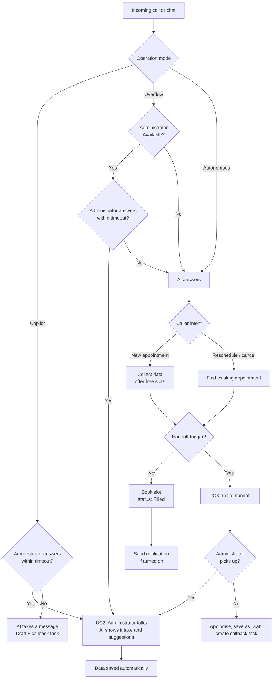
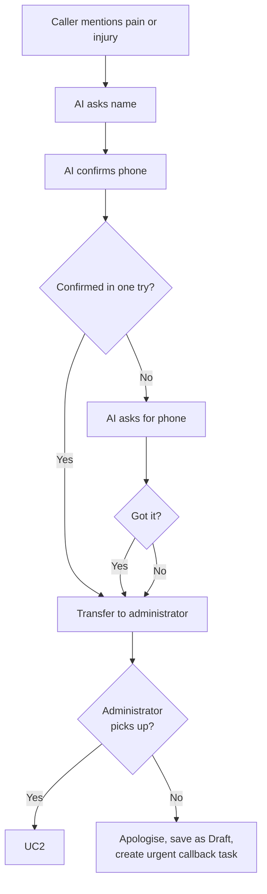
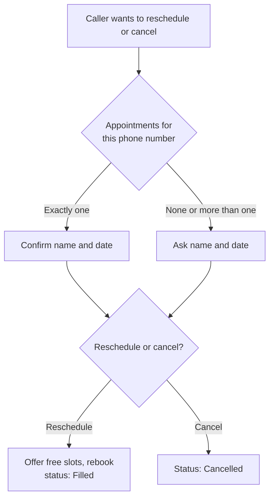
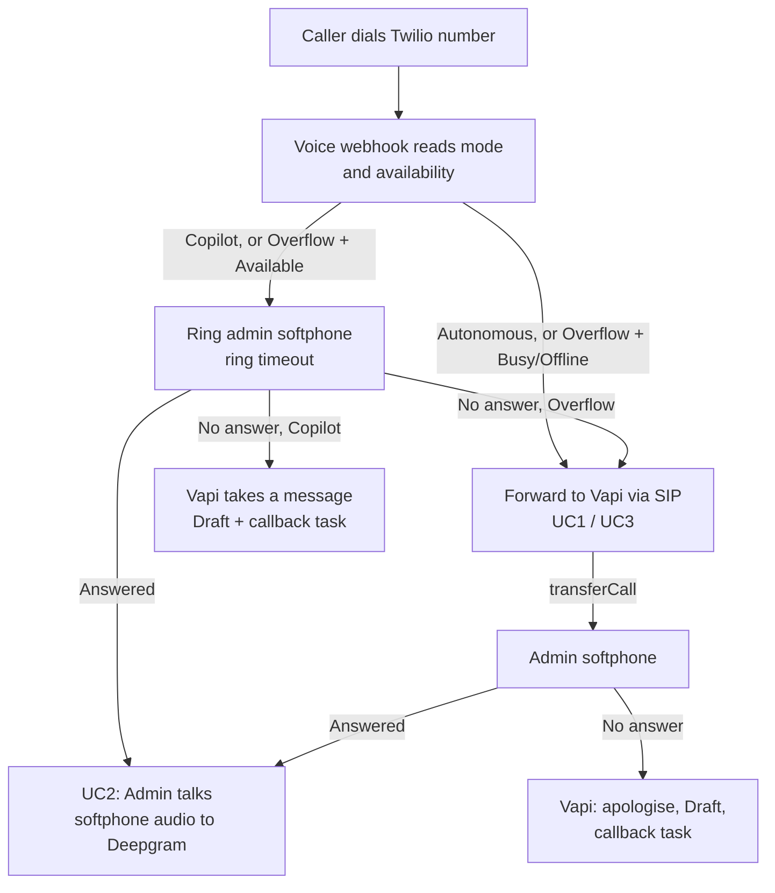

# Demo Process: AI Call Assistant for a Dental Clinic

## 1. Scope

- **Niche:** dental clinic.
- **Channels:**
  - live phone call to a real number from a SIP-telephony provider;
  - text chat on the clinic web page (chat mode). It uses the same rules, data and tools as calls.
- **Language:** English only.

## 2. Actors

| Actor | Description |
|---|---|
| Administrator | Real person (business owner or clinic administrator). Only one in the demo. |
| Caller | Patient or potential patient who needs a dental service. Calls or writes in the chat. |
| AI Assistant | Our system. It answers calls and chats, talks to the caller and books appointments. |

## 3. System Components

### 3.1 Administrator web page
- **Appointments:** list of appointments with their statuses.
- **Schedule:** a shared clinic schedule plus each doctor's schedule.
- **Conversations:** the live call / chat page, call recordings and transcripts, chat histories.
- **Tasks:** callback and coverage-check tasks (see section 6).
- **AI Assistant settings:** operation mode, administrator availability, notifications (see 3.3).
- **Clinic data:** clinic profile and hours, doctors and their schedules, services, knowledge base (see 3.4).

### 3.2 Live conversation page
Opens for every call or chat, whether the AI or the administrator is talking. It shows:
- the current funnel stage (detected automatically from speech or text);
- **intake:** appointment fields, with the filled ones and the missing ones marked;
- the conversation script with the estimated current position in it;
- **suggestions** for the administrator: the next question to ask, free slots that match the request,
  the knowledge-base answer for the caller's question, and a warning when a handoff trigger fires;
- the live transcript (speech-to-text for calls, messages for chats).

All data is saved automatically while the conversation goes on. Every call is recorded and transcribed.

### 3.3 AI Assistant settings

**Operation mode** (one for the clinic, changed by the administrator):

| Mode | Phone call | Chat |
|---|---|---|
| Copilot | Rings the administrator. The administrator always talks; the AI only assists (UC2). If nobody answers within the ring timeout, the AI takes a message: name, phone and reason, saves a **Draft** and creates a callback task. It does not book. | The administrator replies. The AI shows intake and suggestions. If nobody replies within the chat timeout, the AI takes a message as for calls. |
| Overflow (default) | If the administrator is **Available**, the call rings the administrator for the ring timeout (default 5 sec, about 2 rings); with no answer, the AI answers. If the administrator is **Busy** or **Offline**, the AI answers at once. | If the administrator is Available, the chat waits for the chat timeout (default 30 sec) for the administrator to reply; otherwise the AI replies. Busy or Offline: the AI replies at once. |
| Autonomous | The AI answers every call at once. The administrator can watch the live page. | The AI replies to every chat at once. |

**Administrator availability:** Available, Busy or Offline. Set by the administrator on the web page.
Busy or Offline also means a handoff goes straight to a callback task (no live transfer).

**Notifications** (off by default):

| Setting | Values |
|---|---|
| Channel | Off, SMS, email |
| Events | Booked, rescheduled, cancelled, reminder before the visit |
| Reminder time | Hours before the visit (default 24) |
| Templates | Text per event, with fields such as name, service, doctor, date and time |

The AI tells the caller about a notification only when one is turned on for that event.

### 3.4 Clinic data (managed in the web page)

All data is kept in the database and edited on the administrator web page. Nothing is edited in files.

- **Clinic profile:** name, address, time zone, currency, opening hours per weekday.
- **Doctors:** name, speciality, working hours, busy blocks.
- **Services.** Each service has these fields:

| Field | Example |
|---|---|
| Name | Teeth cleaning |
| Urgent | yes / no |
| Price range | CAD 80–120 |
| Expected duration | 45 min |
| Doctor speciality | Hygienist |

- **Knowledge base:** FAQ entries (question, answer, category) entered in a form, plus uploaded files.
- **Schedule access:** the AI reads free slots and books them itself.

When the administrator saves a change that the AI uses (services, knowledge base, hours, doctors), the AI
prompt is rebuilt and pushed to the voice agent automatically.

## 4. Appointment Data

| Field | Required |
|---|---|
| Patient name | Yes |
| Phone (calls: auto-detected from caller ID, confirmed by caller; chat: asked) | Yes |
| Service | Yes |
| Date and time | Yes |
| New or returning patient | Yes |
| Complaint | Yes |
| Doctor | No. The caller may choose a doctor; otherwise one is assigned automatically later |
| Insurance type | No. Dental configs only. None, private plan or CDCP (see section 6, Insurance) |
| Insurance company | No. Dental configs only. Only for a private plan |
| Insurance member ID | No. Dental configs only. Private plan member ID or CDCP member ID |

## 5. Appointment Statuses

| Status | Meaning | Set by |
|---|---|---|
| Draft | Data is still being collected, or the conversation ended before booking | System |
| Filled | All required fields are filled and the slot is booked | System |
| Completed | The patient came to the visit | Administrator (manually) |
| Cancelled | The appointment was cancelled | System (on caller request) or administrator |
| Missed | The patient did not come to the visit | Administrator (manually) |

Slots are not held during the conversation. The slot is booked at the confirmation step. If it was taken in the
meantime, the AI offers the alternatives from the slot selection rule.

## 6. AI Rules

- The AI **never** gives medical advice.
- The AI books the slot itself once all required fields are collected. No approval by the administrator is needed.
- **Slot selection:**
  1. The AI asks whether the caller wants the nearest available day or a preferred day.
  2. The AI proposes a time on that day.
  3. If the time does not fit, the AI proposes three alternative slots:
     - the same date, another time;
     - the same time, another date;
     - a random free slot within the next one or two days.
- The caller may ask for a specific doctor or only for a service (any doctor).
- Confirmation messages are sent only if notifications are turned on (section 3.3).
- **Handoff triggers** (demo only):
  1. A question that is not covered by the knowledge base.
  2. An urgent case (severe pain, injury).
  3. The caller asks for a human.

### Tasks

The system creates a task when the administrator must act after the conversation.

| Task type | Created when |
|---|---|
| Callback | A handoff was not picked up, the administrator is Busy or Offline during a handoff, or Copilot mode took a message |
| Urgent callback | An urgent case could not be transferred (shown first in the list) |
| Coverage check | Dental configs only. An appointment is booked with a private plan or CDCP |

Each task has: type, patient, phone, linked appointment and conversation, due time, status.

| Task status | Set by |
|---|---|
| Pending | System (on creation) |
| Acknowledged | Administrator (working on it) |
| Resolved | Administrator (done) |
| Declined | Administrator (not needed) |

### Insurance

Dental configs only. Non-medical configs (sushi, plumber, locksmith) have no insurance fields, no CDCP and no
coverage check tasks.

Based on the rules of the Canadian Dental Care Plan (CDCP) and private dental plans in Canada.

1. The AI asks whether the caller has dental insurance.
2. **Private plan:** the AI asks the insurance company and, optionally, the member ID. It says that staff will
   check the coverage with the plan and that the patient should bring the insurance card.
3. **CDCP:** CDCP is only for people with no other dental insurance. The AI asks about a private plan first.
   With no other plan, the AI asks for the CDCP member ID (optional) and says to bring the CDCP member card and
   a photo ID.
4. The AI **never** confirms eligibility, coverage, co-payment or the amount that the plan pays. It says that staff
   will check it before treatment and tell the patient about any cost to pay before treatment starts.
5. Booking an appointment with insurance creates a **coverage check** task. Staff then:
   - CDCP: check eligibility and the co-payment level with Sun Life before every treatment (the co-payment can
     change when the patient renews); request preauthorization for services that need it; tell the patient
     about the co-payment and any amount above the CDCP fee;
   - private plan: get the patient's consent to send their data to the plan, request a predetermination for
     larger treatments, and tell the patient their share of the cost.
6. The demo does not contact Sun Life or insurance companies and submits no claims.

## 7. Process Flow

### 7.1 Urgent case

If the phone cannot be obtained, the AI still transfers the call. The administrator then gets the phone from the caller.
The AI gives no medical guidance in an urgent case.

### 7.2 Reschedule / cancel

### 7.3 Chat mode

The chat follows the same flows. The differences:
- The AI asks for the phone number, because there is no caller ID.
- A handoff means the administrator joins the chat on the live page. If nobody joins within the chat timeout,
  the AI apologises, saves a Draft and creates a callback task.
- There is no recording; the chat history is saved instead of a transcript.

## 8. Use-Cases

### UC1: AI handles the call or chat and books an appointment
1. The caller dials the clinic number or opens the chat.
2. The operation mode and the administrator availability send the conversation to the AI (section 3.3).
3. The AI answers and greets the caller.
4. The administrator can watch the live page: transcript, funnel stage and fields being filled.
5. The AI finds out the service, a preferred doctor (optional), new or returning patient, the complaint and insurance.
6. The AI asks for the name and confirms the phone number.
7. The AI asks whether the caller wants the nearest day or a preferred day, then proposes a time. If the time does not fit, it proposes three alternatives (see Slot selection in section 6).
8. The caller picks a slot. The AI books it, and the status becomes **Filled**. With insurance, a coverage check task is created.
9. The AI confirms the details and ends the conversation. A notification is sent if turned on.
10. The recording (calls), transcript and appointment are available on the web page.

### UC2: Administrator handles the conversation, AI assists
1. The caller dials the clinic number or opens the chat.
2. The administrator answers (Copilot mode, or Overflow mode while Available).
3. The AI listens, converts speech to text and detects the funnel stage automatically.
4. The live page shows the funnel stage, the intake fields (filled and missing), the script and the estimated position in it, the suggestions and the transcript.
5. The administrator uses the missing fields, the script and the suggestions to guide the conversation.
6. The appointment is saved automatically: **Draft** while data is incomplete, **Filled** once it is complete and booked.

### UC3: AI hands the conversation over to the administrator
1. Steps 1–3 of UC1.
2. During the conversation a handoff trigger fires (not in the knowledge base, urgent case, or a request for a human).
3. The AI tells the caller politely that it will connect them to the administrator.
4. The call is transferred live, or the administrator is invited to the chat. If the administrator is Busy or Offline, this step is skipped (go to step 6).
5. The administrator picks up. The live page already shows the collected data and the transcript so far. The conversation continues as UC2.
6. If the administrator does not pick up, the AI apologises, saves the appointment as **Draft**, creates a callback task and promises a call-back.

## 9. Demo Script

Preparation:
- On the Clinic data pages, fill in the knowledge base (FAQ, prices, address, opening hours), services, doctors and schedules with some busy and some free slots.
- Set the operation mode to Overflow and the administrator to Available. Turn SMS notifications on for "Booked".
- Open the administrator web page.

| # | Scenario | What the presenter does | What to show |
|---|---|---|---|
| 1 | UC1: booking | Calls, does not answer on the admin side, asks for teeth cleaning on a preferred day, rejects the proposed time | AI proposes three alternatives (same date other time, same time other date, random slot in 1–2 days), books one; the live page fills in; status Filled; SMS sent; recording and transcript |
| 2 | UC1: specific doctor | Calls, asks for a specific doctor | AI books a slot in that doctor's schedule |
| 3 | UC1: reschedule | Calls from the same number as in #1 | AI finds the single appointment, confirms name and date, moves it |
| 4 | UC1: cancel | Calls, cancels | Status Cancelled |
| 5 | UC2: manual call | Administrator answers | Funnel stage, intake fields, suggestions and script position update from speech; data saved automatically |
| 6 | UC3: out of knowledge base | Calls, asks a question not in the knowledge base | Polite handoff, live transfer, admin sees collected data and transcript |
| 7 | UC3: urgent case | Calls, mentions severe pain | AI asks name, confirms phone, transfers |
| 8 | UC3: ask for a human | Calls, asks to speak to a person | Live transfer |
| 9 | UC3: admin does not pick up | Repeat #8, administrator ignores the transfer | AI apologises, Draft saved, callback task created, call-back promised |
| 10 | Medical advice | Asks the AI whether to take antibiotics before the visit | AI refuses to advise and offers an appointment |
| 11 | Insurance: CDCP | Calls, asks whether the clinic takes CDCP, books | AI asks about other insurance first, promises no coverage, books; coverage check task created |
| 12 | Mode: Busy | Sets the administrator to Busy, calls | AI answers at once without ringing the administrator |
| 13 | Mode: Copilot | Sets Copilot, calls, administrator does not answer | AI takes a message; Draft and callback task created |
| 14 | Chat booking | Books through the web chat | Same flow as #1 in text; live page shows the chat |
| 15 | Clinic data | Adds a FAQ entry on the web page, then asks it in the chat | AI answers with the new entry |

## 10. Demo Stand Architecture

### 10.1 Components

| Component | Tool | Role |
|---|---|---|
| Phone number, call routing | Twilio (number + voice webhook) | Asks the backend for the mode and the administrator availability, then rings the administrator or forwards the call to Vapi |
| Administrator softphone | Twilio Voice JS SDK | Administrator answers calls and receives AI transfers in the web page |
| Voice AI agent (UC1, UC3) | Vapi | Speech-to-text (Deepgram), LLM, text-to-speech, tool calls, call transfer |
| Chat | Chat widget on the clinic page + Edge Function + LLM | Text conversations with the same prompt rules and tools as the voice agent |
| Speech-to-text for UC2 | Deepgram (streaming) | Transcribes the administrator's call from the softphone audio |
| Notifications | Twilio SMS, email provider | Sends patient notifications when turned on |
| Backend | Supabase Edge Functions | Call routing, Vapi events, tool calls, chat, the UC2 observer LLM, notifications, temporary Deepgram keys, rebuilding and pushing the agent prompt |
| Storage and push | Supabase Postgres + Realtime | Stores clinic data, settings, calls, chats, transcripts, call state, bookings and tasks; pushes changes to the page |
| Administrator web page | GitHub Pages (static HTML) + `supabase-js` | Shows schedule, appointments, live page, recordings, transcripts and tasks; edits settings and clinic data |
| Seed data | `schedule.json`, `agent-config.json` in the repo | Load the first clinic data into the database. After that the database is the single source |

Secrets (Vapi, Twilio, Deepgram, LLM, email keys) are kept only in Supabase Edge Functions. The page signs in the
administrator to edit data; anonymous access stays read-only.

### 10.2 Call routing

### 10.3 Data flow

**UC1 / UC3 (Vapi or the chat AI talks):**
1. Vapi or the chat function sends events (transcript or messages, status, tool calls, end-of-conversation report) to a Supabase Edge Function.
2. The agent calls tools that the Edge Function handles:
   - `get_free_slots(service, doctor?, date?)` reads the schedule and bookings;
   - `book_slot(...)`, `reschedule(...)`, `cancel(...)` write bookings and send notifications if turned on;
   - `find_appointments(phone)` finds existing appointments;
   - `create_task(type, ...)` creates callback and coverage check tasks;
   - `update_call_state(stage, fields, script_step)` is called after every step and stores the funnel stage, the fields and the script position.
3. The Edge Function writes to Postgres. Realtime pushes the changes to the page.

**UC2 (administrator talks):**
1. The page gets a temporary Deepgram key from an Edge Function (calls only).
2. The softphone audio (two channels: administrator and caller) is streamed from the page to Deepgram. In a chat the messages are used instead.
3. The page sends transcript chunks to an Edge Function.
4. The observer LLM returns the funnel stage, the fields, the script position and the suggestions. The Edge Function writes them to Postgres, and Realtime pushes them to the page.

### 10.4 Common agent config

The database holds everything shared by the voice agent, the chat AI and the UC2 observer (first loaded from `agent-config.json`):
- funnel stages and the conversation script;
- appointment fields and which are required;
- services (name, urgent, price range, duration, doctor speciality);
- knowledge base;
- AI rules (slot selection, no medical advice, insurance) and handoff triggers;
- operation mode, timeouts and notification settings;
- speech-to-text settings: model, language `en`, key terms (services, doctor names).

Three prompts are built from it:

| Prompt | Used by | Instruction |
|---|---|---|
| Agent prompt | Vapi (UC1, UC3) | Talk to the caller, follow the script, call tools |
| Chat prompt | Chat function (UC1, UC3) | Same as the agent prompt, for text; ask for the phone number |
| Observer prompt | Edge Function (UC2) | Do not talk; read the transcript, return stage, fields, script position and suggestions as JSON |

When the administrator saves a change, an Edge Function rebuilds the prompts and pushes the agent prompt, tools and
speech-to-text settings to Vapi through its API. The same speech-to-text settings are used for the Deepgram stream in
UC2, so transcripts have the same quality in all use-cases.
